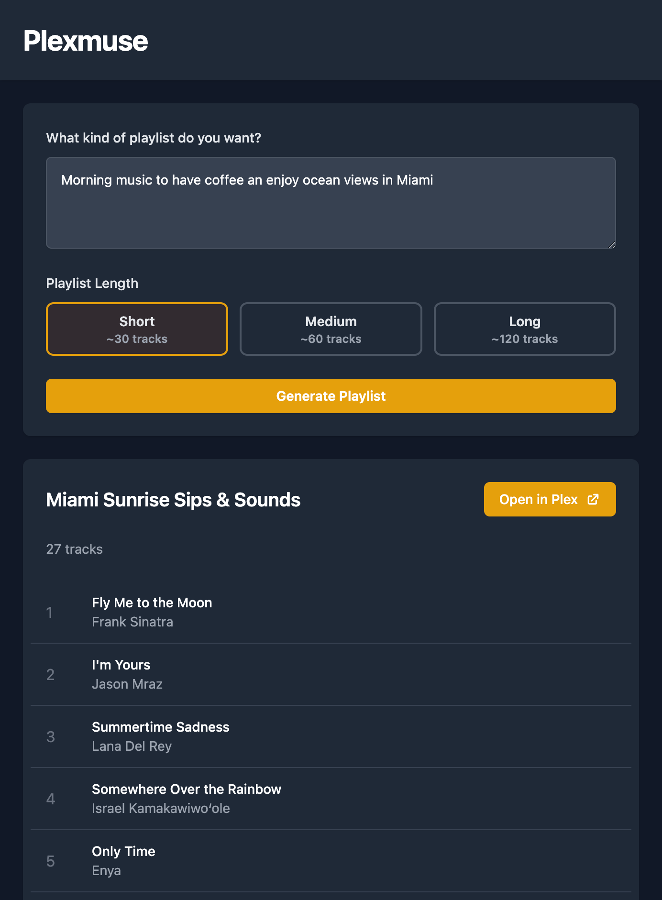

# Plexmuse 🎶🤖

Welcome to **Plexmuse**! This project leverages the power of AI to generate personalized playlists from your Plex music library. Whether you're looking for new music recommendations or creating the perfect playlist for any occasion, this API has got you covered.

## Features ✨

- **AI-Powered Recommendations**: Generate playlists using advanced language models like GPT-4 and Claude.
- **Configurable Model & Provider**: Pick any [LiteLLM](https://docs.litellm.ai/docs/providers)-supported model (OpenAI, Anthropic, Gemini, …) via a single environment variable — no code changes.
- **Multiple Music Libraries**: Works across every music library on your server, regardless of what they're named.
- **Seamless Plex Integration**: Fetch and manage your music library directly from Plex.
- **Customizable Playlists**: Tailor your playlists with specific prompts and models.

## Getting Started 🚀

### Prerequisites

- Python 3
- Plex Media Server with a Music library
- OpenAI API Key (for GPT-4)
- Anthropic API Key (optional, for Claude)

### Installation

1. **Clone the repository**:
    ```sh
    git clone git@github.com:LubergAlexander/plexmuse.git
    cd plexmuse
    ```

2. **Setup**:
    ```sh
    make all
    ```

3. **Set up environment variables**:
    Create a .env file in the root directory and add your API keys:

    ```sh
    cp .env.example .env
    ```

    To find `PLEX_BASE_URL` and `PLEX_TOKEN`, refer to the Plex support article: [Finding an Authentication Token (X-Plex-Token)](https://support.plex.tv/articles/204059436-finding-an-authentication-token-x-plex-token/).

    For setting up OpenAI, Anthropic, or other LLM keys, follow the instructions in the LiteLLM documentation: [LiteLLM - Set Keys](https://docs.litellm.ai/docs/set_keys).

### Configuration ⚙️

The LLM model, provider, and API key are all configurable via environment variables, so you can switch providers without changing any code.

| Variable | Required | Description |
| --- | --- | --- |
| `PLEX_BASE_URL` | Yes | URL of your Plex Media Server, e.g. `http://192.168.1.10:32400`. |
| `PLEX_TOKEN` | Yes | Your Plex authentication token. |
| `PLEXMUSE_MODEL` | No (default `gpt-4`) | Any [LiteLLM model string](https://docs.litellm.ai/docs/providers). Sets the default model and selects the provider. |
| `PLEXMUSE_MODELS` | No | Comma-separated list of models to offer in the UI dropdown. The default model is always included. |
| `OPENAI_API_KEY` / `ANTHROPIC_API_KEY` / … | Depends on model | The API key for whichever provider your model(s) use. |

The API key required is determined by the chosen model. If it is missing or empty, the app fails fast with a clear error naming the environment variable to set, rather than making a doomed API call.

Examples:

```sh
# Use Anthropic Claude
PLEXMUSE_MODEL=anthropic/claude-3-5-sonnet-latest
ANTHROPIC_API_KEY=sk-ant-...

# Offer a choice of models in the UI
PLEXMUSE_MODEL=gpt-4o
PLEXMUSE_MODELS=gpt-4o,gpt-3.5-turbo,anthropic/claude-3-5-sonnet-latest
OPENAI_API_KEY=sk-...
ANTHROPIC_API_KEY=sk-ant-...
```

### Running the Application

You can run the application using the Makefile or directly with Docker.

#### Using the Makefile

1. **Set up and run the application**:
    ```sh
    make run
    ```

#### Using Docker

1. **Build the Docker image**:
    ```sh
    docker compose build
    ```

2. **Start the Docker container** (reads configuration from your `.env` file):
    ```sh
    docker compose up
    ```

#### Using `docker run` with inline configuration

You can also configure the model, provider, and API key directly at launch:

```sh
docker run -p 8000:8000 \
  -e PLEX_BASE_URL=http://your-plex-server:32400 \
  -e PLEX_TOKEN=your-plex-token \
  -e PLEXMUSE_MODEL=anthropic/claude-3-5-sonnet-latest \
  -e ANTHROPIC_API_KEY=sk-ant-... \
  ghcr.io/lubergalexander/plexmuse:latest
```


## Usage 📖

### User Interface

Access the user interface at the root route `/`. This UI allows you to interact with the API, select playlist length, and is mobile-friendly.



### API

Send a POST request to `/recommendations` with the following JSON body:

```json
{
    "prompt": "Chill vibes for a rainy day",
    "model": "anthropic/claude-3-5-sonnet-latest",
    "min_tracks": 10,
    "max_tracks": 20
}
```

### API Documentation

Open your browser and navigate to `http://127.0.0.1:8000/docs` to explore the API endpoints.
